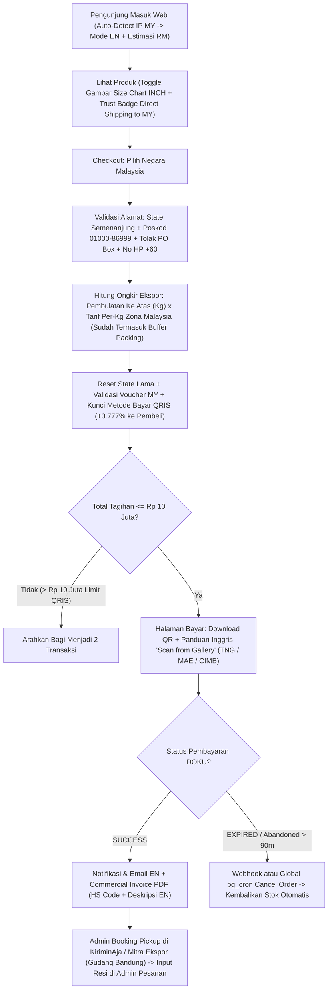

# 🇲🇾 Spesifikasi Teknis Final: Ekspansi Pengiriman ke Malaysia

> **Status Dokumen: FINAL — SIAP EKSEKUSI (*Locked Specification*)**
> Seluruh 10 keputusan bisnis telah dikonfirmasi dan diperbarui untuk mengakomodasi pengiriman dari gudang **Bandung (`40164`)** menggunakan skema **Ekspedisi Internasional Fleksibel berbasis Per-Kg (via KiriminAja / Mitra Kurir Ekspor Bandung seperti Ninja Crossborder & Lion Parcel INTERPACK)** — menggantikan Paxel International yang hanya melayani pickup Jabodetabek. Dokumen ini menjadi acuan tunggal perubahan database (aman untuk database produksi yang sudah berisi data), backend, Edge Functions, UI pelanggan/admin, hingga SOP operasional **Benangbaju** ke Malaysia.

---

## 📌 Ringkasan 18 Aspek Lintas Negara (Berdasarkan Keputusan Final)

### Kelompok A — Fondasi Transaksi Inti (*Core Checkout & Payment*)
| Kode | Aspek | Spesifikasi Final yang Dikunci |
|---|---|---|
| **A1** | **Ekspedisi Internasional Per-Kg, Buffer & Batas Berat** | Menggunakan skema **Tarif Per-Kg Fleksibel di Admin (`shipping_rates`)** yang memayungi **KiriminAja International** (mitra **Ninja Xpress Crossborder** / **Lion Parcel INTERPACK**) dengan *pickup* langsung dari gudang **Bandung**. Tarif dihitung per kilogram (`base_price` + `price_per_kg`) sudah termasuk **Buffer Kemasan & Selisih Volumetrik Ekspor** (dapat diedit kapan saja lewat Admin tanpa ubah kode). Mendukung pengiriman hingga **20–30 kg dalam 1 nomor resi** (plus tetap mendukung input multi-resi dipisah koma jika pesanan besar dibagi beberapa koli). Fokus utama **Semenanjung Malaysia (13 Negeri/Wilayah)** dengan poskod `01000–86999`; poskod Malaysia Timur (`87000–98999`: Sabah, Sarawak, Labuan) & alamat *P.O. Box* ditolak otomatis di tahap awal. |
| **A2** | **Pembayaran QRIS & Biaya Layanan** | **DOKU QRIS Antarnegara (DuitNow QR)** tanpa PT. Pembeli Malaysia membayar dalam **RM (MYR)** via Touch 'n Go, Maybank MAE, CIMB, Public Bank, dll.; *settlement* ke DOKU tetap **IDR** (batas regulasi QRIS maks **Rp 10.000.000/transaksi**). **Biaya MDR QRIS (`0.777%`) dibebankan ke pembeli** dan divalidasi ulang di server. |
| **A3** | **Mata Uang & Estimasi Kurs** | Harga dasar & tagihan database tetap `BIGINT` **IDR**, didampingi tampilan estimasi **`≈ RM`** berbasis kurs yang diatur Admin (`site_settings.myr_exchange_rate`). |
| **A4** | **Bahasa (`ID–EN`) & Deteksi Geo-IP** | Switcher pasar ringan **`ID (Rp)` ↔ `MY (EN / ≈ RM)`** yang **otomatis aktif** ke mode Malaysia saat pengunjung pertama kali masuk dari IP Malaysia (`x-vercel-ip-country` / `cf-ipcountry` di `src/proxy.ts`). |

### Kelompok B — Katalog, Ukuran Gambar Inci, Pencarian & Kepercayaan (*Product, Sizing & Trust UX*)
| Kode | Aspek | Spesifikasi Final yang Dikunci |
|---|---|---|
| **B1** | **Gambar *Size Chart* Format `INCH`** | Karena panduan ukuran produk berupa **gambar upload**, ditambahkan kolom baru **`products.size_guide_inch`** di database & form Admin Produk. Di halaman produk pelanggan tersedia *toggle* **`CM` / `INCH`** (otomatis default menampilkan gambar `INCH` untuk mode Malaysia, dengan *fallback* ke gambar `CM` + keterangan `1 inch = 2.54 cm` jika produk lama belum memiliki gambar inci). |
| **B2** | **Kamus Pencarian Produk Benangbaju** | Perluasan [`CLOTHING_SYNONYMS`](file:///d:/Aulia%20Project/benangbaju/src/modules/products/product-search.ts#L5-L67) sesuai lini produk nyata Benangbaju (**baju, celana, rok, obi belt**): `seluar`/`palazzo`/`slack` ↔ `celana`/`kulot`, `skirt` ↔ `rok`, `baju t`/`tee`/`blouse`/`top` ↔ `kaos`/`blus`/`kemeja`/`baju`, `ikat pinggang`/`bengkung` ↔ `obi`/`sabuk`. |
| **B3** | **Sinyal Kepercayaan & Janji Toko Kontekstual** | Saat mode `ID`, banner promo domestik tetap tampil seperti sekarang. Saat mode `MY`, *Announcement Bar*, badge bawah tombol beli, & `TrustStrip` otomatis berubah menjadi nilai jual Malaysia: *"🇲🇾 Direct International Shipping to West Malaysia from Bandung"* • *"Pay Easily via DuitNow / Touch 'n Go QR"* • *"100% Authentic Apparel from Bandung"*, serta penghapusan klaim Kartu Kredit di `CaraBelanjaPage`. |

### Kelompok C — Gudang, Bea Cukai & Pengiriman (*Warehouse & Customs*)
| Kode | Aspek | Spesifikasi Final yang Dikunci |
|---|---|---|
| **C1** | **Bea Cukai Transparan (*DDU / De Minimis RM 500*) & *Commercial Invoice*** | Pengiriman lintas negara via agregator (KiriminAja / kurir mitra) secara default menggunakan skema **DDU (*Delivered Duty Unpaid*)** dengan informasi transparan di Checkout & S&K bahwa paket pakaian bernilai wajar (di bawah ambang *de minimis* bea masuk Malaysia **RM 500 / ±Rp 1,8 juta**) umumnya bebas bea masuk, namun pajak impor/LVG atau biaya *customs clearance* (bila timbul sesuai regulasi Bea Cukai Malaysia) merupakan tanggung jawab penerima (atau mengikuti skema DDP bila opsi kurir DDP diaktifkan). PDF *Commercial Invoice* wajib dicetak dan ditempel di luar paket (*Country of Origin: Indonesia*, deskripsi barang **Bahasa Inggris tanpa merek**, kode HS pakaian `6204`/`6206`/`6217`, *Declared Value* IDR). |
| **C2** | **Katalog Murni Tekstil & Aturan *Freebies*** | Karena katalog murni pakaian kain (`baju, celana, rok, obi belt` — tanpa cairan/parfum), **tidak perlu** kolom pembatas produk udara (`is_international_eligible` ditiadakan agar DB ramping). SOP gudang cukup memastikan tidak menyelipkan *free gift* fisik yang tidak tercatat di invoice (diganti kartu voucher). |
| **C3** | **Berat Volumetrik Ekspor & Berat Default** | Pengisian `weight_gram` disesuaikan rumus berat volumetrik udara internasional $(P \times L \times T) / 5000$ terhadap lipatan kemasan *polymailer*/kardus, serta penyeragaman fallback berat kosong (`DEFAULT_WEIGHT_GRAM = 400`) di kode client & server agar tidak terjadi error `CART_CHANGED`. |
| **C4** | **Live Tracking Multi-Kurir Ekspor, Zona Waktu & Masa Selesai** | Kolom `tracking_number` mendukung 1 nomor AWB utama (maupun multi-resi dipisah koma bila paket besar dibagi beberapa koli) dengan deteksi link lacak otomatis ke kurir mitra ekspor (**Ninja Van Malaysia / Ninja Crossborder**, **Lion Parcel INTERPACK**, **Pos Malaysia / EMS**, atau pelacak universal **17TRACK / KiriminAja**), penanda eksplisit **`WIB (GMT+7)` vs `MYT (GMT+8)`**, serta jeda konfirmasi pesanan selesai ekspor `10–14 hari kerja`. |

### Kelompok D — Keuangan, Promo, Purna Jual & Iklan (*Finance, Promo, After-Sales & Ads*)
| Kode | Aspek | Spesifikasi Final yang Dikunci |
|---|---|---|
| **D1** | **Purna Jual, Retur & Refund (*Final Sale*)** | Pesanan Malaysia bersifat **Final Sale** (tombol *"Ajukan Retur Barang"* mandiri disembunyikan karena form retur hanya untuk bank lokal Indonesia). Klaim cacat produksi / salah kirim ditangani via WhatsApp CS (*voucher* 100% / kirim ulang). |
| **D2** | **Validasi Server `paymentFee` & Pemisahan CSV Ekspor** | Biaya layanan QRIS (`0.777%`) dihitung ulang secara *server-side* dari `(subtotal - diskon + ongkir)` dan dibebankan ke pembeli. Admin Pesanan mendukung filter/ekspor CSV terpisah Domestik (`ID`) vs Ekspor (`MY`). |
| **D3** | ***Guardrail* Negara pada Voucher** | Penambahan kolom `applicable_countries` pada `vouchers` (*Semua Negara*, *Khusus Indonesia*, *Khusus Malaysia*) + validasi ulang otomatis saat alamat diganti di Checkout. |
| **D4** | **Atribusi *Marketing Pixel*, SEO & Analitik Negara** | Penguncian parameter `currency: 'IDR'` pada seluruh event GA4/GTM/Meta/TikTok Pixel (mencegah Rp 285.000 terbaca sebagai RM 285.000), `eligibleRegion: ['ID', 'MY']` pada Schema.org, serta kartu perbandingan omzet `ID` vs `MY` di Admin Analytics. |

### Kelompok E — Hukum, Privasi Data & Keamanan Database Produksi (*Legal, PDPA & DB Safety*)
| Kode | Aspek | Spesifikasi Final yang Dikunci |
|---|---|---|
| **E1** | **Kepatuhan UU PDP Indonesia & PDPA Malaysia** | Pembaruan halaman Kebijakan Privasi & S&K mencakup *Cross-Border Data Transfer* (ke platform agregator KiriminAja & mitra kurir internasional di Malaysia), prinsip **PDPA Malaysia 2010**, ketentuan pajak bea cukai lintas negara & *Final Sale*, serta *Governing Law* (Hukum Republik Indonesia). |
| **E2** | **Pelepasan Stok Otomatis (`pg_cron` Global)** | Penambahan jadwal `pg_cron` setiap 15 menit untuk membatalkan otomatis order `pending_payment` yang kedaluwarsa (`> 90 menit`) & mengembalikan stok varian, ditambah penanganan status `EXPIRED` di `check-payment-status`. |
| **E3** | **Normalisasi Telepon `E.164` & Migrasi *Zero-Downtime*** | Penyimpanan nomor telepon format baku (`+60...` vs `+62...`) dan eksekusi migrasi SQL menggunakan pola aditif yang **100% aman bagi database yang sudah berisi data transaksi**. |

---

## 🔄 Alur Checkout, Pengiriman Per-Kg (KiriminAja / Mitra Ekspor) & Pembayaran Malaysia

---

## 🚨 Bagian 1: 7 Temuan Bug & Celah Mikro yang Akan Sekalian Diperbaiki

1. **Bug Lookup `zone_id` Selalu `null` tanpa Autocomplete di [`AddressModal`](file:///d:/Aulia%20Project/benangbaju/src/modules/users/components/AddressModal.tsx#L209-L226)**: Mengubah query dari `shipping_zones.name` ke `shipping_zone_coverage` (`country_code` + `province_name`), sekaligus melakukan *auto-backfill* untuk alamat pelanggan lama yang terlanjur memiliki `zone_id = NULL`.
2. **Bug State *Stale* di [`CheckoutPage`](file:///d:/Aulia%20Project/benangbaju/src/app/(customer)/checkout/page.tsx#L193-L221) & Validasi Server `paymentFee` ([`createSecureOrderAction`](file:///d:/Aulia%20Project/benangbaju/src/modules/orders/actions.ts#L263-L268))**: Menghitung ulang `paymentFee` (`0.777%` QRIS) secara reaktif saat ongkir/diskon berubah, me-reset channel/voucher saat negara alamat berganti, dan menghitung ulang `paymentFee` secara mandiri di server.
3. **Bug Potongan Voucher Persentase di SQL [`create_order`](file:///d:/Aulia%20Project/benangbaju/sql_scripts/16_doku_direct_api_and_fee_config.sql#L127-L140)**: Memperbaiki perhitungan diskon `percentage` + `max_discount` + kuota pemakaian yang sebelumnya hanya memotong sebesar angka mentah `vouchers.value`.
4. **Ketidaksinkronan Berat `0` vs `null` ([`CheckoutPage`](file:///d:/Aulia%20Project/benangbaju/src/app/(customer)/checkout/page.tsx#L180-L181) vs [`calculateCartWeight`](file:///d:/Aulia%20Project/benangbaju/src/modules/shipping/shipping.utils.ts#L35-L40))**: Menyeragamkan helper berat keranjang antara client & server dan menyesuaikan `DEFAULT_WEIGHT_GRAM` ke bobot wajar pakaian (`400g`).
5. **Stok Terkunci pada *Abandoned Checkout* & Status `EXPIRED` di [`check-payment-status`](file:///d:/Aulia%20Project/supabase/functions/check-payment-status/index.ts#L92-L97)**: Menambahkan pemanggilan `cancel_order` saat DOKU mengembalikan `EXPIRED` serta memasang penyapu global `pg_cron`.
6. **Anti-*Spoofing* Poskod Sabah/Sarawak (`87000–98999`) & Alamat *P.O. Box***: Memblokir poskod Malaysia Timur (`>= 87000`) dan kata kunci `P.O. Box` / `Peti Surat` pada alamat Malaysia Barat.
7. **Penertiban 4 Titik Klaim Janji Toko**: Menyesuaikan *Announcement Bar* [`CustomerLayout`](file:///d:/Aulia%20Project/benangbaju/src/shared/components/CustomerLayout.tsx#L130-L140), badge [`ProductInfoSection`](file:///d:/Aulia%20Project/benangbaju/src/modules/products/components/ProductInfoSection.tsx#L299-L315), [`TrustStrip`](file:///d:/Aulia%20Project/benangbaju/src/modules/banners/components/TrustStrip.tsx#L13-L17) saat mode `MY`, serta menghapus klaim *"Kartu Kredit"* di [`CaraBelanjaPage`](file:///d:/Aulia%20Project/benangbaju/src/app/(customer)/cara-belanja/page.tsx#L30-L34).

---

## 🛠️ Bagian 2: Spesifikasi Perubahan File per Layer

### 2.1. Database Migration, RPC & Keamanan Data Lama (`supabase/migrations/` & `sql_scripts/`)

> [!IMPORTANT]
> **Jaminan Aman untuk Database yang Sudah Berisi Data (*Zero-Downtime*)**:
> - Menggunakan `ALTER TABLE ... ADD COLUMN IF NOT EXISTS ... DEFAULT ...` (data alamat, produk, voucher, & pesanan lama 100% utuh).
> - Penambahan zona & tarif Malaysia memakai `INSERT ... ON CONFLICT DO NOTHING` (**bukan** menjalankan ulang `seed.sql` yang menimpa data).
> - Karena beralih dari tier box Paxel ke **skema tarif per-kg fleksibel (KiriminAja / Mitra Ekspor Bandung)**, struktur tabel `shipping_rates` dan RPC `calculate_shipping` **tetap bersih dan kompatibel penuh** dengan rumus domestik yang sudah berjalan.
> - Pembaruan fungsi RPC berparameter baru dibungkus transaksi atomik `BEGIN; DROP FUNCTION IF EXISTS ...; CREATE FUNCTION ...; COMMIT;` untuk mencegah error PostgREST `PGRST203` (*function overloading*).

| Objek Database | File Referensi | Spesifikasi Perubahan Final |
|---|---|---|
| Tabel `user_addresses` | [20260609070001_create_profiles.sql](file:///d:/Aulia%20Project/supabase/migrations/20260609070001_create_profiles.sql#L32-L46) | • Tambah `country_code VARCHAR(2) NOT NULL DEFAULT 'ID'`. • Ubah `district_name` menjadi `DROP NOT NULL`. • *Backfill* otomatis `zone_id` dari `shipping_zone_coverage` untuk alamat Indonesia lama yang `zone_id`-nya sempat `NULL`. |
| Tabel `order_shipping` | [20260610080002_create_orders.sql](file:///d:/Aulia%20Project/supabase/migrations/20260610080002_create_orders.sql#L81-L98) | • Tambah `country_code VARCHAR(2) NOT NULL DEFAULT 'ID'`. • Ubah `district_name` menjadi `DROP NOT NULL`. • Perluas `tracking_number` menjadi `TEXT` agar fleksibel menampung nomor AWB internasional panjang maupun multi-resi (dipisah koma) bila paket besar dibagi menjadi beberapa koli. |
| Tabel `shipping_zone_coverage` | [20260610080004_create_shipping.sql](file:///d:/Aulia%20Project/supabase/migrations/20260610080004_create_shipping.sql#L22-L27) | • Tambah `country_code VARCHAR(2) NOT NULL DEFAULT 'ID'`. • Ganti constraint unik menjadi `UNIQUE (zone_id, country_code, province_name)`. • Seed zona baru **`Malaysia Barat (West Malaysia)`** mencakup 13 Negeri/Wilayah Persekutuan dengan `country_code = 'MY'`. |
| Tabel `shipping_rates` | [20260610080004_create_shipping.sql](file:///d:/Aulia%20Project/supabase/migrations/20260610080004_create_shipping.sql#L37-L48) | • Tambah `max_weight_gram INT NULL` (opsional sebagai batas berat per layanan jika dibutuhkan, mis. `30000` untuk 30 kg). • Seed layanan pengiriman zona Malaysia Barat (cth. **`International Express (MY)`** dengan estimasi `4-7 Hari Kerja`, `base_price = 0`, dan `price_per_kg` awal termasuk buffer kemasan ekspor — **100% dapat diubah atau ditambah layanan baru dari menu Admin → Pengiriman** sesuai tarif aktual KiriminAja / Lion INTERPACK / Ninja Crossborder). |
| Tabel `products` | [20260622081514_add_product_guides_and_make_banner_title_optional.sql](file:///d:/Aulia%20Project/supabase/migrations/20260622081514_add_product_guides_and_make_banner_title_optional.sql#L3-L4) | • Tambah **`size_guide_inch TEXT NULL`** untuk menyimpan URL gambar panduan ukuran berformat Inci. • Tambah **`hs_code VARCHAR(20) NULL`** (default pakaian tekstil bisa diisi per produk atau fallback di invoice `6204` / `6206` / `6217`). |
| Tabel `vouchers` & RPC [`validate_voucher`](file:///d:/Aulia%20Project/supabase/migrations/20260609070007_create_rpc_functions.sql#L71-L170) | [20260610080001_create_promotions.sql](file:///d:/Aulia%20Project/supabase/migrations/20260610080001_create_promotions.sql#L9-L26) | • Tambah `applicable_countries TEXT[] NOT NULL DEFAULT ARRAY['ID', 'MY']`. • Perbarui RPC `validate_voucher` dengan parameter `p_country_code VARCHAR(2) DEFAULT 'ID'`. |
| Tabel `site_settings` | [SettingsForm.tsx](file:///d:/Aulia%20Project/benangbaju/src/app/admin/pengaturan/components/SettingsForm.tsx) | • Insert idempoten (`ON CONFLICT DO NOTHING`) key `myr_exchange_rate` (`'3600'`) dan `enable_malaysia_shipping` (`'true'`). |
| RPC [`calculate_shipping`](file:///d:/Aulia%20Project/supabase/migrations/20260609070007_create_rpc_functions.sql#L12-L61) | [20260609070007_create_rpc_functions.sql](file:///d:/Aulia%20Project/supabase/migrations/20260609070007_create_rpc_functions.sql#L12-L61) | • Tetap menggunakan kalkulasi per-kg standar (`base_price + CEIL(weight_gram / 1000.0) * price_per_kg`) baik untuk domestik (`ID`) maupun Malaysia (`MY`). • Tambahkan filter opsional `max_weight_gram IS NULL OR p_weight_gram <= max_weight_gram` agar jika suatu saat Admin ingin membatasi berat maksimum suatu layanan kurir, sistem otomatis menyaringnya. |
| RPC [`create_order`](file:///d:/Aulia%20Project/benangbaju/sql_scripts/16_doku_direct_api_and_fee_config.sql#L65-L210) | [16_doku_direct_api_and_fee_config.sql](file:///d:/Aulia%20Project/benangbaju/sql_scripts/16_doku_direct_api_and_fee_config.sql#L65-L210) | • Perbaiki kalkulasi voucher persentase + `max_discount` + `used_count`. • Simpan `country_code` ke `order_shipping`. • Validasi alamat `'MY'`: poskod 5 digit `01000–86999`, `payment_channel = 'QRIS'`, voucher mengizinkan `'MY'`, dan `v_total_amount <= 10000000`. |
| Cron `pg_cron` & Analitik | [20260713000006_rate_limit_cron_cleanup.sql](file:///d:/Aulia%20Project/supabase/migrations/20260713000006_rate_limit_cron_cleanup.sql) & [20260610080011_create_rpc_sprint2.sql](file:///d:/Aulia%20Project/supabase/migrations/20260610080011_create_rpc_sprint2.sql) | • Jadwalkan `pg_cron` tiap 15 menit untuk auto-cancel order `pending_payment` > 90 menit & kembalikan stok. • Tambahkan *breakdown* pesanan & omzet `ID` vs `MY` di `get_analytics_data`. |

---

### 2.2. Middleware, Utilities & Backend Modules (`src/proxy.ts`, `src/lib/` & `src/modules/`)

| File | Perubahan yang Harus Dilakukan |
|---|---|
| [src/proxy.ts](file:///d:/Aulia%20Project/benangbaju/src/proxy.ts#L63-L71) | • Baca `x-vercel-ip-country` / `cf-ipcountry`; jika `'MY'` dan cookie `bb_market` belum ada, set otomatis `bb_market=MY`. |
| [src/lib/constants.ts](file:///d:/Aulia%20Project/benangbaju/src/lib/constants.ts) | • Tambah `SUPPORTED_COUNTRIES`, daftar 38 Provinsi Indonesia, **13 Wilayah Semenanjung Malaysia**, `QRIS_MAX_AMOUNT_IDR = 10_000_000`, dan sesuaikan `DEFAULT_WEIGHT_GRAM = 400`. |
| [src/lib/utils/validation.ts](file:///d:/Aulia%20Project/benangbaju/src/lib/utils/validation.ts#L10-L19) | • Tambah `normalizePhoneE164(phone, countryCode)` (`+62` vs `+60`), `validateMalaysiaWestPostalCode(code)` (hanya `01000–86999`, tolak Sabah/Sarawak/Labuan `87000–98999`), dan `hasPoBoxAddress(address)`. |
| [src/lib/utils/shipping.ts](file:///d:/Aulia%20Project/benangbaju/src/lib/utils/shipping.ts#L5-L13) & [format.ts](file:///d:/Aulia%20Project/benangbaju/src/lib/utils/format.ts#L4-L39) | • Perluas `getCourierTrackingUrl` untuk mengenali kurir ekspor & mitra KiriminAja (`ninja` / `ninjavan`, `lion` / `interpack`, `pos` / `ems`, `jnt`, `janio`, `dhl`, dengan *fallback* cerdas ke pelacak universal `https://t.17track.net/en#nums=...` untuk layanan bertanda `international`/`my`). • Tambah `formatApproxMYR`, `buildWhatsAppUrl(phone)` (mendukung `+60` & `+62`), serta format zona waktu `WIB` / `MYT`. |
| [src/modules/products/product-search.ts](file:///d:/Aulia%20Project/benangbaju/src/modules/products/product-search.ts#L5-L67) | • Perluas [`CLOTHING_SYNONYMS`](file:///d:/Aulia%20Project/benangbaju/src/modules/products/product-search.ts#L5-L67) untuk kategori baju, celana, rok, dan obi belt dalam istilah Malaysia/Inggris (`seluar`, `palazzo`, `slack`, `skirt`, `baju t`, `ikat pinggang`, `bengkung`). |
| [src/shared/types/database.ts](file:///d:/Aulia%20Project/benangbaju/src/shared/types/database.ts#L1113-L1153) & [src/modules/products/*](file:///d:/Aulia%20Project/benangbaju/src/modules/products/types.ts#L93-L190) | • Sertakan `size_guide_inch` dan `hs_code` di tipe produk, repository (`product.repository.ts`), service (`product.service.ts`), dan schema validasi Admin (`ProductForm.schema.ts`). |
| [src/modules/shipping/*](file:///d:/Aulia%20Project/benangbaju/src/modules/shipping/types.ts) & [src/modules/orders/*](file:///d:/Aulia%20Project/benangbaju/src/modules/orders/actions.ts#L176-L280) | • Sertakan `country_code` & `max_weight_gram`. • Di [`createSecureOrderAction`](file:///d:/Aulia%20Project/benangbaju/src/modules/orders/actions.ts#L263-L268): hitung ulang `paymentFee` (`0.777%` dibebankan ke pembeli) secara *server-side* dari `payment_fee_config`, validasi alamat `MY`, metode bayar `QRIS`, dan batas Rp 10 juta. |
| [src/modules/notifications/notification.service.ts](file:///d:/Aulia%20Project/benangbaju/src/modules/notifications/notification.service.ts#L62-L90) & [analytics.ts](file:///d:/Aulia%20Project/benangbaju/src/modules/analytics/actions/analytics.ts#L25-L90) | • Notifikasi status pesanan berbahasa Inggris untuk order `MY`, dan ringkasan omzet/order `ID` vs `MY` untuk dashboard Analitik Admin. |

---

### 2.3. Supabase Edge Functions (`supabase/functions/`)

| File | Perubahan yang Harus Dilakukan |
|---|---|
| [supabase/functions/generate-payment/index.ts](file:///d:/Aulia%20Project/supabase/functions/generate-payment/index.ts#L169-L184) | • Kirim `phone` format `+60...` / `+62...` dan `country: order.order_shipping?.country_code ?? 'ID'` ke DOKU, serta validasi batas QRIS Rp 10.000.000. |
| [supabase/functions/check-payment-status/index.ts](file:///d:/Aulia%20Project/supabase/functions/check-payment-status/index.ts#L91-L106) | • Tangani status `EXPIRED` dengan memanggil RPC `cancel_order` agar stok langsung dikembalikan. |
| [supabase/functions/generate-invoice/index.ts](file:///d:/Aulia%20Project/supabase/functions/generate-invoice/index.ts#L170-L245) | • **Format *Commercial Invoice* Standar Bea Cukai Ekspor (KiriminAja / Mitra Kurir)**:   - Cantumkan alamat gudang Bandung (`40164`) + **`Country of Origin: Indonesia`** dan tujuan **`MALAYSIA`**.   - Tampilkan kolom bilingual untuk kepabeanan (`Item Description (Apparel)`, `HS Code`, `Qty`, `Weight (g)`, `Unit Value (IDR)`, `Declared Total (IDR)` — dilengkapi estimasi `MYR`).   - Cantumkan keterangan **`Export Category: Commercial E-Commerce Apparel (100% Textile)`** & nomor resi/AWB jika sudah tersedia. |
| [supabase/functions/doku-webhook/index.ts](file:///d:/Aulia%20Project/supabase/functions/doku-webhook/index.ts#L255-L261) & [send-email/index.ts](file:///d:/Aulia%20Project/supabase/functions/send-email/index.ts) | • Kirim notifikasi pembayaran berhasil & email transaksi dalam Bahasa Inggris apabila `country_code === 'MY'`. |

---

### 2.4. Frontend Pelanggan & Admin (`src/app/`, `src/modules/` & `src/shared/`)

| Area | File Utama | Spesifikasi UI/UX Final |
|---|---|---|
| **Switcher Pasar & Harga `≈ RM`** | `MarketStore` (Zustand + Cookie) & Komponen Harga | • Switcher **`🇮🇩 ID (Rp)` / `🇲🇾 MY (EN · RM)`** di Navbar/Mobile Menu. • Saat mode `MY`, tampilkan estimasi Ringgit di samping harga Rupiah (`Rp 285.000 · ≈ RM 79`) dan terjemahkan navigasi/tombol utama ke Bahasa Inggris. |
| **Gambar Size Chart `INCH`** | [`ProductForm`](file:///d:/Aulia%20Project/benangbaju/src/modules/products/components/ProductForm.tsx#L457-L458), [`ProductSizeGuideModal`](file:///d:/Aulia%20Project/benangbaju/src/modules/products/components/ProductSizeGuideModal.tsx#L61-L130), & [`ProductAccordionTabs`](file:///d:/Aulia%20Project/benangbaju/src/modules/products/components/ProductAccordionTabs.tsx#L106-L131) | • Di Admin Produk: tambah upload/URL gambar **Panduan Ukuran (Inch - Malaysia)** di bawah Panduan Ukuran (CM). • Di Modal Size Chart & Tab Pengiriman/Ukuran halaman produk: tampilkan tab pemilih **`CM` / `INCH`**. Jika mode `MY` aktif dan `size_guide_inch` tersedia, otomatis tampilkan gambar Inci; jika produk lama belum punya gambar Inci, tampilkan gambar CM disertai catatan bantu `1 inch = 2.54 cm`. |
| **Form Alamat Malaysia** | [`AddressModal`](file:///d:/Aulia%20Project/benangbaju/src/modules/users/components/AddressModal.tsx) | • Dropdown Negara (`Indonesia` / `Malaysia`). Untuk `Malaysia`: pilih 13 Negeri Semenanjung, input City/Bandar, Postcode 5 digit (`01000–86999`), HP `+60`, tolak *P.O. Box*, dan perbaiki lookup `fetchZone`. |
| **Checkout Pengiriman Per-Kg & QRIS** | [`CheckoutPage`](file:///d:/Aulia%20Project/benangbaju/src/app/(customer)/checkout/page.tsx) & [`PaymentMethodSelector`](file:///d:/Aulia%20Project/benangbaju/src/app/(customer)/checkout/components/PaymentMethodSelector.tsx) | • Perbaiki *stale state* saat ganti alamat & hitung reaktif biaya layanan QRIS (`+0.777%` dibebankan ke pembeli). • Untuk alamat `MY`: tampilkan layanan kurir internasional beserta total berat (kg), filter pembayaran khusus **QRIS / DuitNow**, tampilkan info transparan bea cukai Malaysia & ketentuan **Final Sale**. |
| **Pembayaran, Live Tracking & Final Sale** | [`OrderPaymentSection`](file:///d:/Aulia%20Project/benangbaju/src/app/(customer)/pesanan/%5BorderNumber%5D/components/OrderPaymentSection.tsx#L172-L198) & [`OrderShippingSection`](file:///d:/Aulia%20Project/benangbaju/src/app/(customer)/pesanan/%5BorderNumber%5D/components/OrderShippingSection.tsx#L35-L53) | • Tambah tombol **Download QR Image** + panduan Inggris 3 langkah *Scan from Gallery* (Touch 'n Go / MAE / CIMB). • Sembunyikan tombol retur mandiri untuk order `MY` (diganti tombol bantuan klaim cacat via WhatsApp). • Tampilkan tombol **Track International Package** per resi (mendukung 1 resi maupun multi-resi dipisah koma). |
| **Banner, Badge, SEO & Legal** | [`CustomerLayout`](file:///d:/Aulia%20Project/benangbaju/src/shared/components/CustomerLayout.tsx#L130-L140), [`ProductInfoSection`](file:///d:/Aulia%20Project/benangbaju/src/modules/products/components/ProductInfoSection.tsx#L290-L315), [`TrustStrip`](file:///d:/Aulia%20Project/benangbaju/src/modules/banners/components/TrustStrip.tsx#L13-L17), Halaman Info & Legal | • Mode `ID` tetap seperti sekarang; Mode `MY` menampilkan *Direct Shipping to West Malaysia from Bandung*, *DuitNow QR*, & *Authentic Apparel from Bandung*. • Kunci `currency: 'IDR'` pada event GA4/Pixel, tambah `eligibleRegion: ['ID', 'MY']` JSON-LD, jam CS `WIB / MYT`, hapus klaim Kartu Kredit di `CaraBelanjaPage`, serta perbarui `PengirimanPage`, `ReturPage`, `KebijakanPrivasiPage` (UU PDP + PDPA Malaysia), & `SyaratKetentuanPage`. |
| **Panel Admin Operasional** | [`AdminOrdersPage`](file:///d:/Aulia%20Project/benangbaju/src/app/admin/pesanan/page.tsx), [`AdminOrderShippingPanel`](file:///d:/Aulia%20Project/benangbaju/src/app/admin/pesanan/%5BorderNumber%5D/components/AdminOrderShippingPanel.tsx), Pengiriman, Voucher & Analitik | • Badge **`🇲🇾 MY - EXPORT`** + ringkasan data kepabeanan (*Declared Value IDR/MYR, Total Berat Gram, & panduan input ke KiriminAja*), tombol WA aman `+60`, filter/ekspor CSV per negara, cakupan negara voucher, setting kurs `MYR`, & kartu analitik `ID` vs `MY`. |

---

## 📋 Bagian 3: Checklist SOP Operasional Gudang & Keuangan Sebelum *Go-Live*

- [ ] **1. Verifikasi Tarif & Pickup KiriminAja / Mitra Ekspor Bandung (`40164`)**: Cek tarif pengiriman internasional dari Sukajadi Bandung (`40164`) ke Kuala Lumpur/Johor di dashboard **KiriminAja** (atau **Lion Parcel INTERPACK** / **Ninja Xpress Crossborder**), lalu sesuaikan angka `price_per_kg` (+ buffer packing) pada zona **Malaysia Barat** di menu **Admin → Pengiriman**.
- [ ] **2. Top-Up Saldo Deposit Agregator Logistik**: Pastikan saldo akun KiriminAja mencukupi untuk pemotongan ongkir saat Admin membuat order *pickup* ekspor.
- [ ] **3. Konfirmasi QRIS Cross-Border Inbound di DOKU**: Pastikan status penerimaan QRIS lintas negara (DuitNow Malaysia) aktif di akun DOKU produksi.
- [ ] **4. *Live Smoke Test* Transaksi Kecil**: Uji 1 transaksi nyata nominal kecil menggunakan aplikasi e-wallet/bank Malaysia (*Scan from Gallery* → *Webhook* → *PDF Commercial Invoice*).
- [ ] **5. Audit Berat Volumetrik & Upload Bertahap Gambar *Size Chart Inch***: Cek `weight_gram` produk berdimensi tebal agar selaras dengan rumus volumetrik $(P \times L \times T) / 5000$, dan mulai unggah gambar panduan ukuran format Inci pada produk *best-seller*.
- [ ] **6. SOP Booking Ekspor & Tanpa *Undeclared Freebies***: Saat mem-booking pengiriman di dashboard KiriminAja, tulis deskripsi produk dalam **Bahasa Inggris generik tanpa nama brand** (misal: *"Women Cotton Blouse"*, *"Woven Skirt"*) beserta nilai barang sesuai invoice, tempelkan cetakan *Commercial Invoice* di luar paket, dan ganti *free gift* fisik menjadi kartu kode voucher.
- [ ] **7. Cek Konfigurasi `currency: 'IDR'` di GTM / Ads Pixel**: Pastikan Meta/TikTok Pixel membaca mata uang `'IDR'` saat mulai beriklan ke audiens Malaysia.

---

## ✅ Bagian 4: Rekap 10 Keputusan Bisnis yang Telah Dikunci (*Locked Decisions*)

| # | Topik Keputusan | Keputusan Final Pemilik Proyek |
|---|---|---|
| 1 | **Ekspedisi & Skema Tarif Malaysia** | **Menggunakan skema Tarif Per-Kg Fleksibel di Admin (via KiriminAja / Mitra Kurir Ekspor Bandung)** menggantikan Paxel yang hanya melayani Jabodetabek. Tarif per-kg sudah ditambah buffer kemasan ekspor dan bebas disesuaikan lewat Admin kapan saja. |
| 2 | **Pesanan Keranjang Berat & Resi** | **Dihitung murni per-kg hingga batas kargo kurir (20–30 kg dalam 1 resi)** tanpa perlu pecah box S/M/L, namun kolom resi tetap mendukung multi-resi (dipisah koma) bila paket besar dibagi beberapa koli. |
| 3 | **Skema Pajak Bea Cukai Malaysia** | **Transparan mengikuti regulasi Malaysia (DDU / *De Minimis* RM 500)**: pembeli diinformasikan secara jujur di Checkout & S&K bahwa bea masuk/pajak impor (bila timbul di Bea Cukai Malaysia) menjadi tanggung jawab penerima, dilengkapi *Commercial Invoice* ber-HS Code untuk memperlancar *customs clearance*. |
| 4 | **Jenis Produk di Katalog** | **Murni pakaian kain (`baju, celana, rok, obi belt`)** — tidak ada produk cairan/aerosol, sehingga skema DB tidak perlu dibebani kolom pembatas produk udara. |
| 5 | **Kurs `RM` & Biaya Layanan QRIS** | Tampilkan estimasi `≈ RM` dengan kurs Admin, dan **biaya MDR QRIS (`0.777%`) tetap dibebankan ke pembeli**. |
| 6 | **Cakupan Negara pada Voucher** | **Disetujui**: tambah opsi cakupan negara pada Voucher (*Semua Negara* / *Khusus Indonesia* / *Khusus Malaysia*). |
| 7 | **Deteksi IP Malaysia & Bahasa** | **Disetujui**: aktifkan *Auto-Detect Geo-IP* di `src/proxy.ts` untuk menyalakan mode `MY (EN + ≈ RM)` otomatis + kamus sinonim Malaysia. |
| 8 | **Format *Size Chart* (`CM` / `INCH`)** | Karena berupa gambar, **tambah kolom `size_guide_inch` di tabel `products`** & upload field di Admin Produk untuk gambar berformat Inci. |
| 9 | **Banner *"Gratis Ongkir"* & Badge** | **Disetujui**: mode domestik `ID` tetap seperti sekarang, dan otomatis berubah kontekstual ke *Direct International Shipping to Malaysia* saat pengunjung berada di mode `MY`. |
| 10 | **Final Sale, Email EN, Cron & Legal** | **Disetujui seluruhnya**: terapkan *Final Sale* khusus Malaysia, notifikasi/email Bahasa Inggris untuk order `MY`, `pg_cron` pelepasan stok kedaluwarsa, serta update Kebijakan Privasi (UU PDP + PDPA Malaysia) & S&K. |

---

## 🗓️ Bagian 5: Urutan Eksekusi Implementasi (*5-Step Execution Plan*)

1. **Step 1 — Migrasi SQL Aman (*Zero-Downtime*), Zona Tarif Per-Kg Malaysia & Cron Stok**
   * Buat file migrasi SQL aditif (`country_code`, `max_weight_gram`, `size_guide_inch`, `hs_code`, `applicable_countries`, `tracking_number TEXT`, *backfill* `zone_id`).
   * Perbarui RPC `calculate_shipping`, `validate_voucher`, `create_order` (fix voucher persentase + validasi MY), `get_analytics_data`, pasang jadwal `pg_cron`, serta seed zona **Malaysia Barat (13 Negeri)** beserta tarif per-kg awal.
2. **Step 2 — Modul Alamat Malaysia, Admin Produk (`size_guide_inch`) & Admin Operasional**
   * Fix bug `fetchZone` di [`AddressModal`](file:///d:/Aulia%20Project/benangbaju/src/modules/users/components/AddressModal.tsx), validasi poskod Semenanjung (`01000–86999`), tolak *P.O. Box*, dan normalisasi telepon `+60`.
   * Tambah upload gambar `size_guide_inch` & `hs_code` di Admin Produk, cakupan negara di Admin Voucher, kurs `MYR` di Pengaturan, serta badge **`🇲🇾 MY - EXPORT`** + info bantu booking KiriminAja + CSV di Admin Pesanan.
3. **Step 3 — Keamanan Checkout, QRIS Cross-Border, Tracking Ekspor & Commercial Invoice PDF**
   * Fix *stale state* di [`CheckoutPage`](file:///d:/Aulia%20Project/benangbaju/src/app/(customer)/checkout/page.tsx) + kalkulasi ulang `paymentFee` di server + fix `EXPIRED` di [`check-payment-status`](file:///d:/Aulia%20Project/supabase/functions/check-payment-status/index.ts).
   * Kunci metode bayar ke `QRIS` untuk Malaysia, tambah tombol *Download QR* + panduan *Scan from Gallery*, sembunyikan retur mandiri (*Final Sale*), render tombol Live Tracking kurir ekspor, dan perbarui [generate-invoice/index.ts](file:///d:/Aulia%20Project/supabase/functions/generate-invoice/index.ts) ke standar *Commercial Invoice* kepabeanan.
4. **Step 4 — Geo-IP Auto-Detect, Market Switcher (`ID ↔ MY`), Sinonim Pakaian & Toggle Gambar `Inch`**
   * Aktifkan deteksi IP Malaysia di [src/proxy.ts](file:///d:/Aulia%20Project/benangbaju/src/proxy.ts), pasang *Market Switcher* & tampilan harga `≈ RM`.
   * Perluas [`CLOTHING_SYNONYMS`](file:///d:/Aulia%20Project/benangbaju/src/modules/products/product-search.ts#L5-L67) (`seluar`, `skirt`, `palazzo`, `bengkung`, dll.), tambahkan *toggle* gambar **`CM` / `INCH`** di [`ProductSizeGuideModal`](file:///d:/Aulia%20Project/benangbaju/src/modules/products/components/ProductSizeGuideModal.tsx) & [`ProductAccordionTabs`](file:///d:/Aulia%20Project/benangbaju/src/modules/products/components/ProductAccordionTabs.tsx), serta sesuaikan banner/badge janji toko secara kontekstual.
5. **Step 5 — Notifikasi Inggris, Zona Waktu (`WIB/MYT`), SEO/Pixel, Analitik & Halaman Legal**
   * Aktifkan notifikasi & email Bahasa Inggris untuk order Malaysia, jam operasional `WIB / MYT`, `eligibleRegion` Schema.org, penguncian `currency: 'IDR'` pada event analitik/pixel, kartu analitik `ID` vs `MY` di Admin, serta pembaruan halaman Cara Belanja, Pengiriman, Retur, Kontak, Kebijakan Privasi (UU PDP + PDPA Malaysia), dan S&K.
